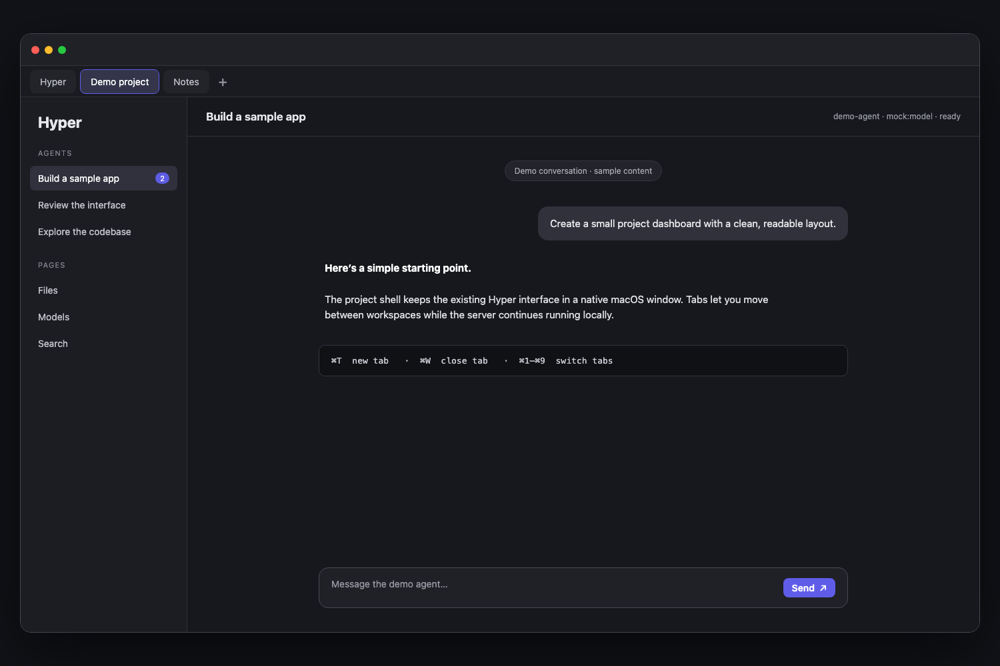

# Hyper Desktop

Тонкая macOS-оболочка для локального Hyper. Приложение показывает существующий веб-интерфейс в `WKWebView` и при необходимости просит `launchd` запустить установленный сервис.

Исходный проект: [hyper-code](https://github.com/hyper-code-harness/hyper-code).



Иконка приложения: 

## Вкладки

- `⌘T` — новая вкладка.
- `⌘W` — закрыть текущую; закрытие последней вкладки закрывает окно.
- `⌘1`–`⌘9` — перейти к соответствующей вкладке.

## Границы

- Исходники Hyper остаются изменяемыми в `~/code/hyper-code`.
- `.hyper/` остаётся runtime-overlay рядом с checkout и не упаковывается в `.app`.
- PostgreSQL внешний; оболочка не устанавливает и не запускает базу.
- Порт приложения сейчас `3010`, адрес — только `127.0.0.1`.
- Процесс Hyper и его обновления остаются под управлением существующего LaunchAgent.

## Сборка

Нужны macOS 13+, Swift 6 и установленный LaunchAgent Hyper.

```sh
swift build
./scripts/package-app.sh
open dist/Hyper.app
```

`scripts/package-app.sh` создаёт локально подписанный `.app` для разработки. LaunchAgent label можно задать через `HYPER_LAUNCH_AGENT_LABEL`; по умолчанию используется `com.hypercode.server`. Для распространения потребуются Developer ID signing и notarization.

Исходник иконки находится в `Assets/AppIcon.png`; скрипт сборки создаёт из него `.icns` для Dock и Finder.

## CI и версии

GitHub Actions собирает и проверяет `.app` на `push` в `main` и на каждом pull request. Версия хранится в `VERSION` по SemVer; сейчас это `0.1.0`.

Чтобы выпустить версию:

1. Обновить `VERSION`, закоммитить и отправить изменение в `main`.
2. Дождаться зелёного CI.
3. Создать и отправить соответствующий тег, например:

   ```sh
   version=$(cat VERSION)
   git tag -a "v$version" -m "Hyper Desktop $version"
   git push origin "v$version"
   ```

Тег `vX.Y.Z` должен совпадать с `VERSION`. Release workflow собирает `Hyper.app`, прикладывает ZIP и SHA-256 checksum к GitHub Release с автоматически созданными заметками.

CI подписывает приложение ad hoc. Для установки загруженных релизов на других Mac нужны Developer ID signing и notarization; они пока не настроены.
